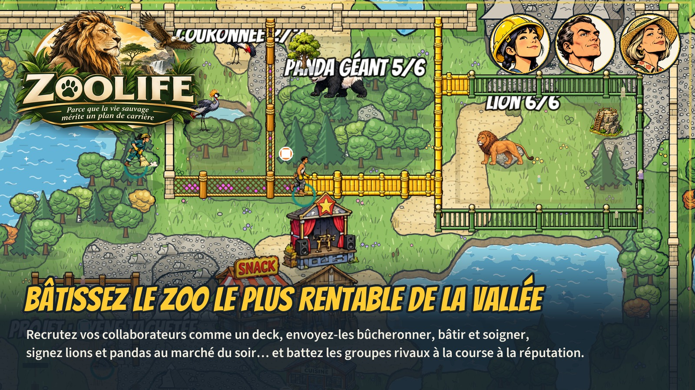

# ZooLife — Parce que la vie sauvage mérite un plan de carrière

**En une phrase** : un jeu de gestion où vos employés sont vos cartes, où chaque animal exige son coin de nature, et où trois groupes rivaux veulent la même concession que vous.

La vallée attend son zoo, et ZooLife™ vous en confie la filiale. Petit souci : trois groupes rivaux visent la même concession, et votre supérieur, Hubert de la Marge, compte chaque centime (surtout les vôtres).

**Le jour**, vos collaborateurs sont des cartes. Piochez-les, mobilisez-les, et regardez-les couper du bois, monter l'enceinte, creuser un bassin ou tenir le guichet. Chacun a son caractère : la paysagiste qui transforme une prairie en jungle, l'apprenti qui progresse à vue d'œil, le maçon paresseux qu'on garde quand même.

**Pour accueillir un animal**, il faut lui offrir son terrain : sable et prairie pour le guépard, forêt et rochers pour le léopard des neiges, de l'eau pour l'hippopotame. On le trouve, ou on le façonne case par case.

**La nuit**, le conseil d'administration se réunit : on signe des contrats au marché, on recrute, on joue ses cartes d'action. Le premier en influence choisit le bonus du lendemain, et la filiale à la traîne décroche un plan de relance.

Le premier à 100 de réputation remporte la concession. Seul contre l'IA (trois niveaux) ou jusqu'à quatre en réseau.
